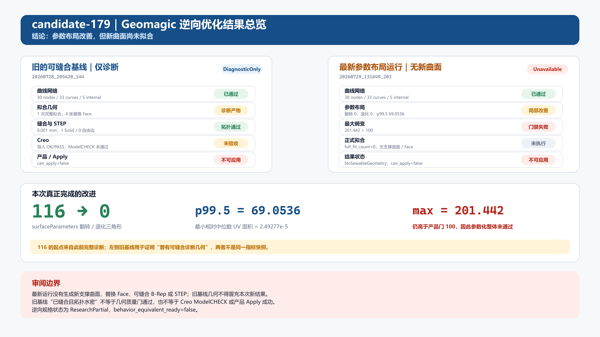
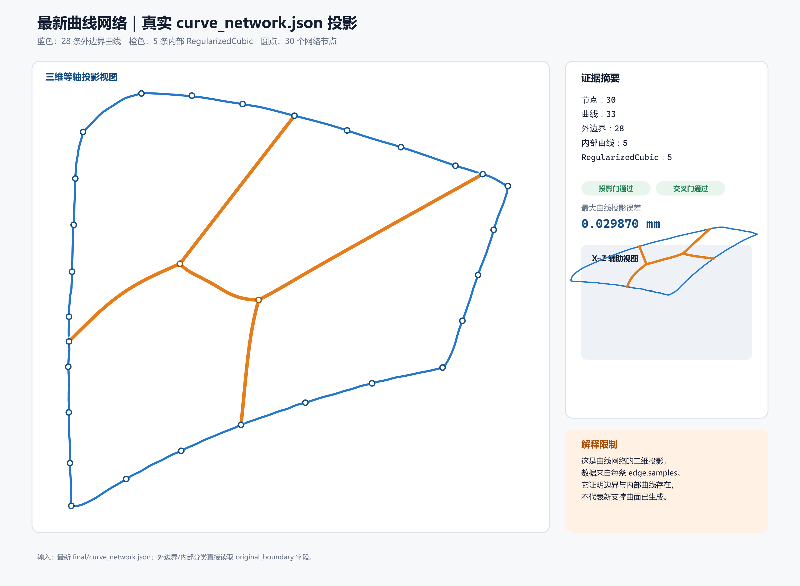
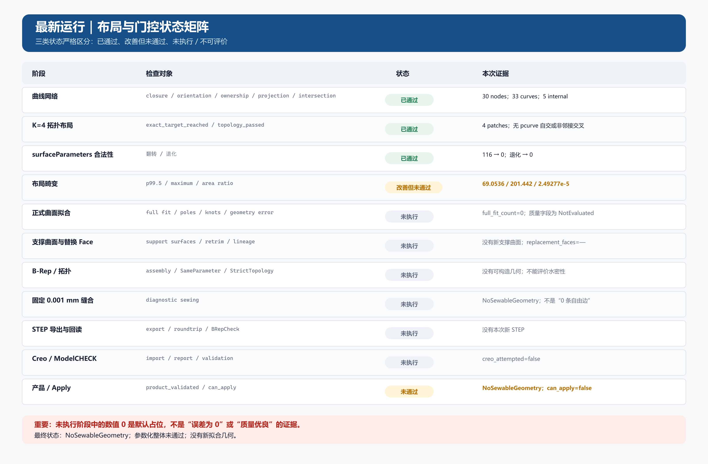

# candidate-179 四面片结果归档

本目录保存用户当前选定的形状效果参考基线：先构造曲线骨架和分片布局，再拟合曲面、裁剪与缝合。采用的实际几何来自 `20260729_032156_431` 的四面片诊断运行；后续单面片实验不替代这一结果基线。

## 直接审阅

| 内容 | 文件 |
|---|---|
| 四张裁剪后的替换面 | [trimmed_patch_faces.step](final/evidence/previous_full_diagnostic_20260729_032156/trimmed_patch_faces.step) |
| 四张未裁剪支撑曲面 | [untrimmed_support_surfaces.step](final/evidence/previous_full_diagnostic_20260729_032156/untrimmed_support_surfaces.step) |
| 对应曲线骨架 | [curve_network.step](final/evidence/previous_full_diagnostic_20260729_032156/curve_network.step) |
| 实测质量记录 | [validation_summary.json](final/evidence/previous_full_diagnostic_20260729_032156/validation_summary.json) |
| 原运行参数与源码状态 | [run.json](final/evidence/previous_full_diagnostic_20260729_032156/run.json) |
| 各版本 STEP 来源说明 | [STEP_README.md](final/STEP_README.md) |
| 完整原始证据包 | [evidence_bundle.zip](evidence_bundle.zip) |

两份约 100 MB 的 `diagnostic_sewn.step` 整件保存在压缩包中，其余原始文件可直接在仓库中查看。压缩包完整保留原 `final/` 下的 35 个文件，包括上述四面片结果、此前的可缝合基线，以及后续只完成参数布局的实验记录。

在本目录中执行以下命令，将完整证据解压到独立目录：

```powershell
Expand-Archive -LiteralPath .\evidence_bundle.zip -DestinationPath .\restored_evidence
```

采用的整件路径为 `restored_evidence/final/evidence/previous_full_diagnostic_20260729_032156/diagnostic_sewn.step`。

## 结果边界与代码追溯

- 该结果仍为 `DiagnosticOnly`、`can_apply=false`；面内褶皱、几何质量门和 Creo ModelCHECK 未通过的问题保留在原始记录中。
- 本包中的 `20260729_131649_203` 布局实验没有进入正式拟合，不能把四面片 STEP 当作该次实验新生成的曲面。
- 原运行的 Git 记录为 `90282b9`、`dirty=true`。分支保留相关源码历史及后续演进；该运行记录不等同于一个可精确复现实测结果的干净源码快照。
- 本次只归档既有结果并标记当前采用基线，没有重新拟合或改变实验指标。压缩包内 35 个文件已逐一解压并与原文件按字节对照，18 个 JSON 已解析通过。

## 原有可视化

以下图片保留原有阶段说明，其中“最新”指当时的参数布局实验；实际采用的四面片几何以上方 STEP 和运行编号为准。






