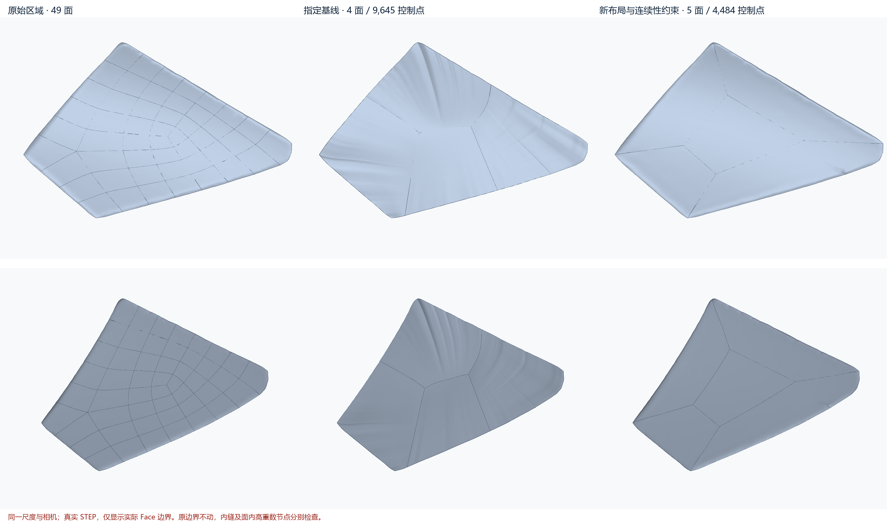

# candidate-179：放开人工内缝与控制网的实证

本轮保住原始 26 条外边界后，重新构造内部布局并联合拟合，已经得到 **5 面、4484 控制点、一个有效完整实体**的阶段候选。与指定 4 面 / 9645 点基线相比，控制点减少 53.5%，形状与内外接缝法向明显改善；仍未通过最大法向、单方向控制点预算及 Creo GEOM_CHECKS，因此保持 `DiagnosticOnly / can_apply=false`。面数由 4 增至 5 的收益是避免两条复杂外边在同一张量网格中相乘传播，不是以增加面数自动换取合格。

## 审阅入口

本次整理仅保留当前策略 `five_knot_smooth` 的几何。其他实验的数值与失败原因继续保留，几何、临时资源和压缩包已清理。

- [原始 49 面区域](original_region.step)。
- [指定四片基线](../20260729_candidate_0179_geomagic_reverse_optimization_visualization/final/evidence/previous_full_diagnostic_20260729_032156/trimmed_patch_faces.step)；原有基线归档保持原样。
- 当前策略：[局部五张面片](five_knot_smooth/patch_faces.step)、[独立支撑面](five_knot_smooth/support.step)、[缝合后整件 STEP](five_knot_smooth/whole_model_diagnostic.step)。
- [原始／基线／当前策略同视角对比图](figures/comparison_five_knot_smooth.png)。
- [完整指标表](comparison.csv)、[机器记录](run.json)、[参数协议](protocol.json)、[归档保留范围](archive_retention.json)。



原始整件不在本次上传范围；需要重新进行整件替换或外侧邻面审计时，提供 `input_audit.json` 所指的原始整件 STEP。局部原始区域和共享样本已保留，可用于继续拟合与误差分析。

## 对截图与基线的修正判断

9645 是四张支撑面的控制点总数，截图中的密集细条不能直接当作更多 CAD 面。本轮按实际 Face 边界计算最小旋转包围矩形，基线四面的投影长宽比约为 1.25–1.35，真实面轮廓并不细长；其控制网方向密度高度不均匀。五面方案主要改变控制网及复杂度分配，并没有使所有 Face 更接近方形：首选方案四个外围面长宽比约为 1.81–5.01，大中央面方案外围达到 3.83–10.50。这是实际代价，不能称作面轮廓均匀性全面改善。

首轮已实测：指定基线几乎就是原边界 Coons 填充，旧联合拟合在零次迭代时因逻辑边表达预算失败；并非收敛后的最优四片。基线原边位置保持良好，可以闭合，但外侧要求 G1 的关系最大法向差约 67.63°。前轮冻结所有旧人工缝/导数会保留错误切向。详见 [首轮](../20260921_candidate179_evidence/RUN.md) 和 [水密补充轮](../20260921_candidate179_hard_boundary/RUN.md)，不把该结论推成“四片数学上不可能”。

## 实现与输入合同

原始整件 `D:\pyProject\step-patch-optimizer\data\stp\03_配件_Clay.stp`，2739 面；区域按零基 FaceId 1702–1750 提取。指定几何运行 `20260729_032156_431` 的运行源码为 `90282b948bc073c3b6f7e8804c25526780626807` 且 dirty=true；归档提交 `bfe1412574a623225657543cf1af140b0ae3b294` 不等于那次 dirty 源码的完整快照。当前实验在独立工作树，原始模型、指定基线、原研究树修改及 49→46 产品回归均未覆盖。

以原始区域同一批 12000 训练点、18000 评估点和原始法向为真值，复用原种子；反向使用候选面积分布的 6000 点，种子 181。反向点在不同候选上不是相同 XYZ，但面积采样规则、数量与评价器相同。单位统一为 mm；距离均是绝对距离，不是相对误差。固定点和最坏点另用 OCCT 查询复核。最大值为采样结果，不是连续域上界。

将原 26 条三维边曲线、顶点与 1e-7 mm 边容差原样带入新 B-Rep。每条原边映射到对应面的等参边界，外圈位置变量消去；不是靠边界罚权。四条径向缝和四条中央面边使用共享主曲线变量，精确共享 C0 位置；旧人工缝不再冻结。原外边连接、曲线落面、SameParameter、Face/Wire 方向和整件缝合独立验证。

各配置预先给定一套平面布局，内部角点和曲线高度随联合解变化；本轮尚未自由优化全部 XY 控制点。软目标取自原区域内侧面在外边上的法向，评价时再独立与未替换的外侧面比较；没有把 G0 特征强行改为 G1。内部梯度匹配与公平项也是软约束。仅改变高度并不是用户约束，而是这个可执行对照的表示选择，报告未将其包装成任意曲面设计器。

拟合目标包括位置、原始梯度、物理 X/Y Hessian 公平项、原始区域的外边法向及内部缝梯度匹配。权重分别见 [protocol.json](protocol.json)：法向项 1e-4 mm²、公平项 1e-6 mm⁴、外边梯度项 0.01 mm²、内缝梯度项 1 mm²；节点光顺对照额外使用 0.1 mm²。稀疏正规方程的最终相对线性残差约 1e-15，不支持“这批拟合仅因未迭代收敛而失败”的解释；这不构成对所有病态性的排除。

原曲线拼接使用 OCCT [GeomConvert_CompCurveToBSplineCurve](https://dev.opencascade.org/doc/occt-7.8.0/refman/html/classGeomConvert__CompCurveToBSplineCurve.html)。没有接入新开源算法或新增依赖，实际版本见 [dependencies.json](dependencies.json)。本轮决定来自原始数据与可控原型，不是因为某论文方法的名称。

## 有限实验与可比较结果

先作四片均衡布局的构造预检：准确保留原曲线时，Coons 控制网为 54×70、38×54、70×38、70×71，总数 13462，比基线更大。原外边每条都是 18 点三次曲线；在 1e-10、1e-8、1e-7 mm 下尝试 OCCT 节点删除均未降低这些曲线点数。这只否定该次节点删除路径，不能否定其他参数化或表示的压缩能力。因此主实验转为一个中央四边面、四个外围面，每个外围面仅接一条复杂外逻辑边。

配置按诊断证据从最初三组补充到七组，原因与修正保留于 [protocol_amendment.json](protocol_amendment.json)。75 分钟是拟合与诊断搜索预算，文档归档另计；最终七组均已完成，未继续无界调参。

| 配置 | 实际面 / 控制点 | 正向最大 / RMS mm | 反向最大 mm | 法向 P95 / 最大 ° | 人工缝最大 ° | 面内 C0 节点跳变 ° |
|---|---:|---:|---:|---:|---:|---:|
| baseline | 4 / 9645 | 0.07679 / 0.02159 | 0.07680 | 13.58 / 65.30 | 18.37 | — |
| hard_c0 | 4 / 9645 | 0.02260 / 0.00206 | 0.02392 | 5.65 / 38.13 | 65.27 | — |
| hard_c1 | 4 / 9645 | 0.04469 / 0.00550 | 0.04403 | 10.81 / 65.25 | 18.37 | — |
| five_balanced | 5 / 3600 | 0.06410 / 0.00515 | 0.07864 | 10.69 / 50.38 | 0.93 | 8.80 |
| five_boundary_layers | 5 / 4484 | 0.05639 / 0.00237 | 0.07982 | 3.61 / 51.88 | 0.98 | 14.49 |
| five_compact_seams | 5 / 2572 | 0.09546 / 0.00987 | 0.23390 | 16.08 / 64.83 | 18.49 | 15.68 |
| five_coherent_layers | 5 / 4484 | 0.01103 / 0.00091 | 0.01131 | 1.93 / 18.41 | 0.96 | 7.27 |
| five_knot_smooth | 5 / 4484 | 0.01315 / 0.00097 | 0.01555 | 2.04 / 25.77 | 0.96 | 1.08 |
| five_compact_coherent | 5 / 2572 | 0.02538 / 0.00166 | 0.02783 | 4.90 / 29.68 | 1.76 | 12.69 |
| five_large_panel | 5 / 2892 | 0.03528 / 0.00188 | 0.05122 | 4.58 / 41.41 | 1.31 | 3.75 |

表中前三行复用同一会话前轮的固定输入结果；面内节点跳变未按本轮新检查复算，填“—”，不是零。所有七个新配置都在原 0.001 mm 缝合容差下，一次缝合并 STEP 回读得到 1 Solid、0 自由边、0 多重边、有效 B-Rep；整件实际 2695 Face。没有补洞面，没有提高边容差。

- `five_balanced`：初始 8 点人工缝、无近外边节点层；减少了复杂度，但最大形状与法向仍差。名称表示初始设计假设，不表示实测已达最佳均衡。
- `five_boundary_layers`：只在支撑面增加距外边参数 0.02、0.06 节点层；RMS 降低，但最大误差仍靠近径向缝及角点。见 [最坏区定位](worst_seam_localization.json)。
- `five_compact_seams`：将人工缝降为 4 点三次 Bézier；2572 点却产生 18.49° 接缝误差，首次紧凑尝试失败。
- `five_coherent_layers`：在主缝曲线上也同步加入上述节点，仍为 4484 点；形状明显改善。
- `five_knot_smooth`：同一初始面和变量空间，仅增加两个面内 C0 节点两侧物理梯度匹配；最大节点跳变从 7.27° 降为 1.08°，同时最大法向从 18.41° 上升到 25.77°，是可归因的光顺与原形状折中。
- `five_compact_coherent`：把同步主缝细化用于前次 2572 点配置；恢复低于 0.03 mm 的双向距离，但面内节点跳变仍大。
- `five_large_panel`：中央比例从 0.45 增至 0.75，中央面用 12×12，外围沿内缝增加适当表达。属于布局与基函数共同改变的设计对照。更大的中央面没有带来更好的综合结果，正反向距离和法向均失败。

**归因修正：** 最后核验 [初始参数映射](initial_equivalence.json) 时发现，径向主曲线在 Coons 构造前插节点，也改变了同参数位置及 XY 映射。4484 点对照的最大 XY 差为 0.11113 mm，2572 点对照为 0.19132 mm。因此不能把相应提升单独归因于接缝自由度；能够确认的是“主缝表达与 Coons 参数映射共同改变”的收益。D/E 的初始映射完全相同，节点光顺项对照不受此混杂影响。后续必须将种子面固定后再插节点/改变共享变量，隔离这两个因素。

## 验收、最坏区与 CAD

首选 `five_knot_smooth` 正向最大 0.01315 mm、反向最大 0.01555 mm 均通过原 0.03 mm 距离门；人工缝最大约 0.964°，通过原 5°门。14 条要求 G1 的外边与原外侧面最大法向差约 0.594°，比基线大幅下降，但不是精确 G1 等式成立的声明。外边残差约 8.84e-12 mm，代表数值一致性；42 次边使用的 Curve-on-Surface/SameParameter 检查通过。

首选与大中央面对照又从完整整件 STEP 回读中重新定位五个替换面和所有外侧邻面，核实 26 条接口边的双侧关系；两者曲线落面残差均低于 1e-10 mm，SameParameter 无失败，相关边最大容差仍为 1e-7 mm。见 [整件接口复核](five_knot_smooth/integrated_boundary_audit.json)。这一步没有只检查缝合前的局部五面。

首选最大原始形状法向误差 25.77°，未通过 15°；最坏点位于原 FaceId 1711 附近，XYZ 约 (-27.22325, 38.64771, -8.05043) mm。形状优先对照最大法向 18.41°，最坏点在 FaceId 1706，也未通过。大中央面对照最坏法向 41.41° 在 FaceId 1710，正向最大 0.03528 mm，反向最大 0.05122 mm。当轮误差图使用统一色标；整理后由各候选 evaluation.json 保留最坏点坐标及 OCCT 交叉查询，首选的逐点误差也保留在 evaluation.npz。

实际控制网：首选为 103×10、70×10、135×10、134×10、8×8；大中央面对照为 107×6、74×6、139×6、138×6、12×12。因此中央网格变简单的同时，复杂外边仍使外围面单方向很密。原单方向 25 控制点预算未更改，全部新配置未通过；统计实际 STEP 支撑点，不把独立求解变量数或三角形数量当控制点数。

支撑面稠密 knot 分区采样没有发现 Jacobian 退化或投影方向反转，投影轮廓之间没有超过数值量级的面积重叠；这仍不是连续域无自交证明。本原型没有运行三角网格 UV 优化，不能报告“网格 UV 翻转已全部解决”。高重节点两侧的真实法向跳变与 Face/Wire 方向错误、支撑面折叠是不同检查。局部与整件 OCCT B-Rep 检查有效，也不等于商业 CAD 全部接受。

实际 Creo 11.0.0.0 导入及 ModelCHECK：

| 输入 | GEOM_CHECKS | SHORT_EDGES | 导入校验 | ModelCHECK |
|---|---:|---:|---|---|
| original_model_control | 0 | 1501 | PASS | 未通过 |
| five_knot_smooth | 1 | 1492 | PASS | 未通过 |
| five_large_panel | 1 | 1488 | PASS | 未通过 |

三者均导入为单一零件，导入校验 PASS；原始整件本身存在模板短边项，但 GEOM_CHECKS 为 0，两个新候选均为 1。新增几何错误不能归咎于原模型已有短边，也不能用导入 PASS 覆盖。当前 XML 只定位至导入 Feature id 4，尚未定位到具体曲面；不能未经证实就将其归因于面内节点。没有修改 Creo 模板、精度或短边阈值。解析后的完整数值记录在各自 `creo/result.json`；原生 Creo 文件、XML 及其资源已清理，JSON 中的原路径仅供执行来源追溯；其他五个配置未运行 Creo，明确为 NotRun。

原生 C++ StrictTopologyGate / Apply 未调用；这是隔离原型验证，不改变产品资格。所有候选 `can_apply=false`。

## 下一层决定

保留严格外边及共享 C0 位置变量、以原始样本为真值的拟合和独立闭合检查。证据已经否定“必须冻结旧人工缝或保持 9645 控制点才能水密”的说法，也不支持只删控制点或不断扩大中央面的策略。

下一步优先处理 **Coons 初始参数映射与边界节点传播**：先固定同一初始支撑面，独立改变共享接缝空间，完成缺失的因果对照；再处理外边拼接产生的高重节点及外围支撑表达，避免用整条狭长网格传播局部复杂度。面内连续性应进入约束结构，而不是仅靠软公平项压小法向跳变。具体采用分段边界带、可重参数化的裁剪支撑或其他表示仍需对照，本轮不宣称其中之一已经解决。

先定位 Creo 新增 GEOM_CHECKS 及边界最坏法向，再讨论产品接入；继续沿原生局部模块路线，没有证据要求现在替换整套布局/拟合/B-Rep 流程。四片继续保留为后续布局选项；五片本轮带来可测收益，但不是最终面数决定。

## 修正、代码与复现

新增 `designer_layout.py`、`designer_audit.py`、`integrated_boundary_audit.py`、`designer_visuals.py`、`designer_report.py` 和共享约束数值测试；`integrate.py`、`render.py` 只增加可选 `--patch-file`，保留旧默认入口。四项数值测试通过，包含混合节点基函数下精确外边和共享人工缝，以及避免重复插节点。C++ 产品代码未改，未声称执行了产品构建回归。

两次实现问题已修正并保留原因和指标记录：拼接原曲线未先归一参数域导致等参边匹配失败；随后 `InsertKnot` 的 Add=True 重复增加已经由主缝导入的节点，导致冗余控制点。原因见 protocol_amendment.json，冗余控制点批次的 JSON 保留在 `initial_insert_multiplicity_diagnostic/`。后者修正为 Add=False 后，同一 D/E 配置重跑，最终控制点以 STEP 回读为准。实验阶段未删除失败几何，归档整理时按用户要求清理非首选几何；没有改写采样、公差、质量门或失败指标。

以下命令用于在新目录重新运行完整实验，会重新生成中间产物；不要直接在本精简归档目录执行报告生成器。复现时从当前工作树根运行。先将本轮 `protocol.json`、`reference.npz`、`input_audit.json`、`original_region.step` 复制到新输出目录，更新原始整件路径及必要的前轮/基线入口；不要覆盖本轮目录。引用的前轮样本由 prepare.py 可重建，首轮已有独立重采样一致性记录。拟合、审计、缝合及渲染命令：

```powershell
$py = 'D:\pyProject\3d_engineering\astra_modeling_test\.venv\Scripts\python.exe'
$run = 'data/runs/<新的运行号>'
$base = 'data/runs/20260729_candidate_0179_geomagic_reverse_optimization_visualization/final/evidence/previous_full_diagnostic_20260729_032156'
& $py -m unittest discover -s tools/candidate179_research -p 'test_*.py'
& $py tools/candidate179_research/designer_layout.py --run $run
& $py tools/candidate179_research/designer_audit.py --run $run
& $py tools/candidate179_research/integrate.py --source 'D:\pyProject\step-patch-optimizer\data\stp\03_配件_Clay.stp' --run $run --names five_balanced five_boundary_layers five_compact_seams five_coherent_layers five_knot_smooth five_compact_coherent five_large_panel --patch-file patch_faces.step
& $py tools/candidate179_research/integrated_boundary_audit.py --run $run --names five_knot_smooth five_large_panel
& $py tools/candidate179_research/render.py --run $run --baseline $base --candidate five_knot_smooth --patch-file patch_faces.step --label '连续性诊断 · 5 面 / 4484 点' --footer '原外边不动；完整验收未通过。'
& $py tools/candidate179_research/render.py --run $run --baseline $base --candidate five_large_panel --patch-file patch_faces.step --label '大中央面对照 · 5 面 / 2892 点' --footer '原外边不动；距离与法向验收未通过。'
& $py tools/candidate179_research/designer_visuals.py --run $run
./tools/candidate179_research/run_creo.ps1 -StepPath "$run/five_knot_smooth/whole_model_diagnostic.step" -OutputDir "$run/five_knot_smooth/creo" -CreoRoot 'E:\Proe\Creo 11.0.0.0'
./tools/candidate179_research/run_creo.ps1 -StepPath "$run/five_large_panel/whole_model_diagnostic.step" -OutputDir "$run/five_large_panel/creo" -CreoRoot 'E:\Proe\Creo 11.0.0.0'
./tools/candidate179_research/run_creo.ps1 -StepPath 'D:\pyProject\step-patch-optimizer\data\stp\03_配件_Clay.stp' -OutputDir "$run/original_model_control/creo" -CreoRoot 'E:\Proe\Creo 11.0.0.0'
& $py tools/candidate179_research/designer_report.py --run $run
```

各候选拟合耗时约 17.8–32.2 秒，只包含各配置脚本的构造、反求、求解和局部导出，不包括评估、整件导出、Creo、研发调试，不能当作产品冷/暖运行成绩。本次精简归档仅保留首选局部面、独立支撑面、缝合整件 STEP、原始区域、共享样本、三方对比图和各轮指标。ZIP、非首选几何、重复原始数据、日志及 Creo 临时资源已清理。源码和精简结果随 `experiment/candidate179-evidence-20260921` 分支保存；提交与推送状态以 Git 历史为准，未合并至主线或原研究工作树。
